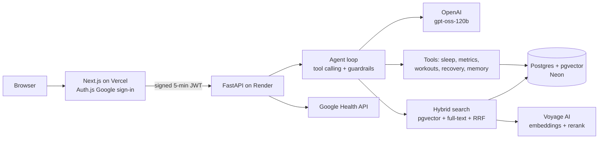

# Fit Me Coach

An AI health coach that reads your Fitbit / Google Health data (sleep, heart rate, HRV, steps, workouts) and gives **grounded, cited advice**, the way WHOOP Coach or Google's Fitbit coach does. Built end to end: RAG, a tool-calling agent, evals, auth, and deployment.

**Live demo:** https://fit-me-coach.vercel.app/ · sign in with Google → ask *"Why am I so tired this week?"*
**Demo video (2 min):** <YOUR_VIDEO_LINK>

> The backend runs on a free tier and sleeps when idle. The first request can take ~1 minute to wake it.

---

## What it does

- **Dashboard:** 14 days of sleep, resting heart rate, HRV, steps and workouts.
- **Coach chat:** ask about your recovery, sleep or training. The coach looks at **your data** and at **trusted health guides**, then answers with numbered citations.
- **Remembers you:** saves stable facts you share ("I train at 6 am") and uses them in later answers.
- **Safety first:** messages about emergencies or self-harm skip the AI entirely and return crisis resources (112, Tele-MANAS 14416).
- **Real data:** sign in with Google, connect Google Health, and your Fitbit data syncs into the same tables. *(Google Health access is in testing mode, limited to approved test users.)*

## Architecture



## How a question is answered

1. **Safety check:** regex red flags route emergencies to a fixed response, so no LLM is involved.
2. **Agent loop:** the LLM decides which tools to call (`get_recovery_summary`, `get_sleep`, `search_guides`, …), up to a step limit.
3. **Retrieval:** hybrid search (vector + keyword, merged with Reciprocal Rank Fusion), then a reranker.
4. **Grounding guard:** every advice point must cite a source ID returned by `search_guides`. Invented or missing citations trigger one retry. Citations are renumbered to `[1]`, `[2]`.
5. **Memory:** the last 6 messages, plus saved user facts (passed as *facts, not instructions*).

## Evals

The agent is tested on a fixed dataset with a known "planted story" in the demo data:

| Check | What it verifies | Score |
|---|---|---|
| right_tools | Called the tools the question needs | <x/13> |
| no_repeats | No duplicate tool calls | <x/13> |
| efficient | Within the step budget | <x/13> |
| cited | Advice backed by retrieved sources | <x/13> |
| LLM judge | Answer matches the rubric | <x/13> |

```bash
python -m scripts.run_agent_evals
```

## Design decisions

| Decision | Why |
|---|---|
| Native python agent loop, no LangChain | Every step is visible and testable. Easy to add guardrails |
| Hybrid search + rerank | Vector search misses exact terms ("HRV"), keyword search misses meaning. Together they cover both |
| Citations checked in code, not trusted from the LLM | Stops the model citing sources it never retrieved |
| `user_id` comes only from the verified token | The AI can never read another user's data, even if prompted to |
| Moved local PyTorch models → Voyage AI | Cut backend memory ~10x so it runs on a 512 MB free instance; evals confirmed quality held |
| Postgres for everything (vectors, health data, memory) | One database, transactions, and simple ops |

## Security & privacy

- Google sign-in only. The Next.js server signs a short-lived JWT for the API (backend-for-frontend pattern). No secrets reach the browser.
- Health OAuth refresh tokens are **encrypted at rest**.
- Question text is **never logged**, only metadata (latency, tools used, safety outcome).
- The MCP server exposes **read-only** tools.
- Deleting a user cascades to all of their health data.

## Tech stack

**Backend:** Python, FastAPI, Postgres + pgvector, psycopg, OpenAI (gpt-oss-120b), Voyage AI, PyJWT, pytest
**Frontend:** Next.js, Auth.js, Tailwind, Recharts
**Also:** MCP server (Python SDK), Docker Compose, Neon, Render, Vercel

## Run locally

```bash
git clone <repo> && cd fit-me-coach
docker compose up -d                                  # Postgres + pgvector on :5433
for f in backend/db/init.sql backend/db/00*.sql; do docker compose exec -T db psql -U coach -d coach < "$f"; done

cd backend
python -m venv .venv && source .venv/bin/activate
pip install -r requirements.txt
cp .env.example .env                                  # fill in keys
python -m scripts.ingest                              # load health guides
python -m scripts.seed_sample_data                    # demo user with 30 days of data
uvicorn app.main:app --reload

cd ../frontend && npm install && npm run dev          # http://localhost:3000
```

## Use it from Claude (MCP)

```bash
claude mcp add fit-me-coach -- /path/to/backend/.venv/bin/python /path/to/backend/mcp_server.py
```

## Limitations & next steps

- Google Health is in OAuth testing mode, so only approved test users can connect, and tokens expire after 7 days.
- Next: tracing with Langfuse, streaming responses, CI that runs tests + evals on every push.

*Not medical advice. Fit Me Coach is a portfolio project.*
